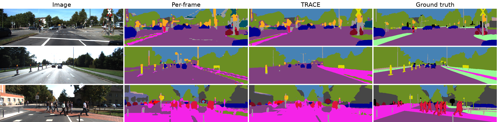

# TRACE: Track-level Region Aggregation with Crop Evidence

Code for the paper **"Static Training-Free Open-Vocabulary Segmenters on Video: Flicker, Hallucination, and a Space-Time Remedy"**.

Md Khalequzzaman Sarker Likhon, Md Malek Sarker

TRACE is a training-free, model-agnostic wrapper that turns any per-frame open-vocabulary segmentation model into a video segmenter. It pools evidence over space-time SAM 2 tracks, classifies each track from its largest views with a video-level class debiasing, and aligns the remaining dense evidence with optical flow. It has an offline and an online (causal) variant.



KITTI-STEP val, middle frame of sequences 0002, 0008 and 0016 (fixed in advance, not selected by result). TRACE removes many spurious regions of the per-frame model, such as poles and traffic lights in vegetation and sky.

## Results

mIoU, per-frame → with TRACE (offline). Hyperparameters were selected on KITTI-STEP training sequences only; the sets below were used once, with a frozen configuration.

| Per-frame model | KITTI-STEP val | CamVid val | CamVid test (1 Hz) |
|---|---|---|---|
| Proxy (DINO B/16) | 34.7 → **41.5** | 45.4 → **57.6** | 39.2 → **46.6** |
| MaskCLIP | 25.4 → **39.5** | 35.4 → **55.1** | 30.7 → **45.0** |
| SCLIP-style | 32.3 → **39.7** | 35.8 → **47.2** | 32.6 → **42.1** |
| NACLIP-style | 33.0 → **40.9** | 38.7 → **50.9** | 36.2 → **47.0** |
| SAM 3 per frame (reference) | 64.6 | 68.7 | 69.4 |

SCLIP-style and NACLIP-style use our reimplementation of each method's attention on CLIP ViT-B/16, not the official code. With the Proxy model, the online variant is 0.4 to 2.1 mIoU below the offline one. SAM 3 is trained with concept-level mask supervision, so it is reported as a reference, not as a training-free method. All numbers, including per-class IoU and consistency metrics, are in [`results/summary.json`](results/summary.json).

## Installation

```bash
conda create -n trace python=3.10 -y
conda activate trace
pip install -r requirements.txt

git clone https://github.com/facebookresearch/sam2.git third_party/sam2
git -C third_party/sam2 checkout 2b90b9f
SAM2_BUILD_CUDA=0 pip install -e third_party/sam2
mkdir -p third_party/sam2/checkpoints
wget -P third_party/sam2/checkpoints https://dl.fbaipublicfiles.com/segment_anything_2/092824/sam2.1_hiera_large.pt
```

The results were produced with PyTorch 2.5.1. DINO, CLIP and RAFT weights download automatically on first use.

The SAM 3 reference needs its own environment and access to the gated [`facebook/sam3`](https://huggingface.co/facebook/sam3) weights on Hugging Face:

```bash
conda create -n trace-sam3 python=3.12 -y
conda activate trace-sam3
pip install -r requirements-sam3.txt

git clone https://github.com/facebookresearch/sam3.git third_party/sam3
git -C third_party/sam3 checkout 7f473cf
pip install -e third_party/sam3
hf auth login
```

Set `SAM2_ROOT` and `SAM3_ROOT` if the repositories are not in `third_party/`.

## Data

Put the datasets under `data/`, or set `TOVSS_DATA` to their location:

```
data/CamVid/{train,trainannot,val,valannot,test,testannot}/        SegNet version, 480x360
data/kitti_step/training/image_02/<seq>/*.png                      KITTI tracking images
data/kitti_step/kitti-step/panoptic_maps/{train,val}/<seq>/*.png   KITTI-STEP labels
```

- **CamVid:** the `CamVid` folder of [SegNet-Tutorial](https://github.com/alexgkendall/SegNet-Tutorial/tree/master/CamVid).
- **KITTI-STEP:** the left colour images of the [KITTI tracking benchmark](https://www.cvlibs.net/datasets/kitti/eval_tracking.php) (`data_tracking_image_2.zip`) and the [KITTI-STEP labels](https://storage.googleapis.com/gresearch/tf-deeplab/data/kitti-step.tar.gz) from [DeepLab2](https://github.com/google-research/deeplab2/blob/main/g3doc/setup/kitti_step.md):

```bash
mkdir -p data/kitti_step && cd data/kitti_step
unzip /path/to/data_tracking_image_2.zip         # gives training/image_02 and testing/image_02
wget https://storage.googleapis.com/gresearch/tf-deeplab/data/kitti-step.tar.gz
tar -xf kitti-step.tar.gz                        # gives kitti-step/panoptic_maps
```

Keep the folders as they are unpacked. The DeepLab2 guide moves them into a different layout, which this code does not use.

## Reproducing the results

```bash
GPU=0 bash scripts/run_heldout.sh kitti_step val
GPU=0 bash scripts/run_heldout.sh camvid val
GPU=0 bash scripts/run_heldout.sh camvid test
```

Each run computes per-frame scores and RAFT flow, builds offline and online tracks, fuses them, and writes `results/<dataset>_<split>__trk2*/{metrics.json,tc.json,preds/}`. `trk2` is offline and `trk2on` is online. KITTI-STEP val takes several hours and about 16 GB of GPU memory.

Then, for the other per-frame models and the SAM 3 reference:

```bash
GPU=0 bash scripts/run_plug.sh kitti_step val
GPU=0 PY_SAM3=/path/to/sam3/env/bin/python bash scripts/run_sam3.sh kitti_step val
```

The frozen configurations are in `configs/`. To keep the held-out sets clean, the code refuses to evaluate a validation or test split with a configuration that is not in one of those files.

After all runs, `python tools/make_paper_numbers.py` writes the paper's main tables and numbers to `paper_output/`, and `python tools/make_qual_figure.py` makes the figure. The hallucination and coverage tables come from:

```bash
python tools/hallucination_stats.py kitti_step_val__trk2__perframe kitti_step_val__trk2__full
python tools/coverage.py kitti_step_val__trk2__full cache/tracks_kitti_step_val --split val --tex
```

## Acknowledgments

This code uses [SAM 2](https://github.com/facebookresearch/sam2), [RAFT](https://github.com/princeton-vl/RAFT) (torchvision), [OpenCLIP](https://github.com/mlfoundations/open_clip) and [DINO](https://github.com/facebookresearch/dino). The per-frame model follows [ProxyCLIP](https://github.com/mc-lan/ProxyCLIP).

## License

The code is released under the MIT License. SAM 2, SAM 3, CLIP, DINO, RAFT, KITTI-STEP and CamVid have their own licenses and terms of use.
